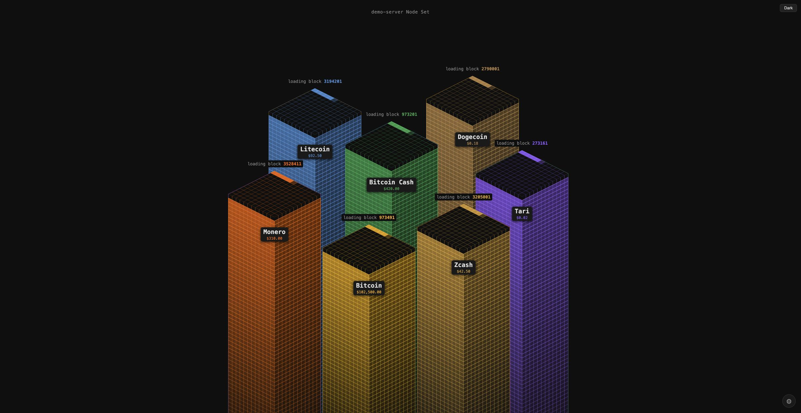
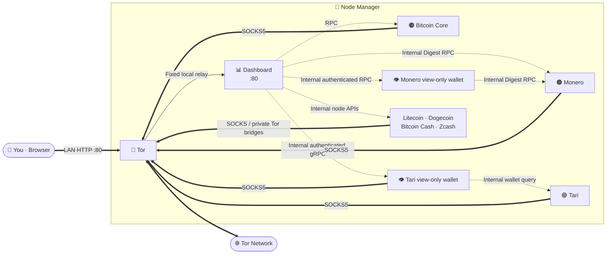

<div align="center">

# Node Manager

### A very lightweight dashboard for monitoring your new or existing nodes.

[](https://github.com/VijitSingh97/bitcoin-starter-stack/actions/workflows/ci.yml)
[](./LICENSE)


Run Bitcoin, Monero, Tari, Litecoin, Dogecoin, Bitcoin Cash, or Zcash with a
small Go dashboard. Choose any combination and click a tower in your node set
to see its status. Public runtime traffic goes through Tor; the dashboard and
optional node APIs stay on your trusted LAN.

The existing repository, package, commands, and data paths keep their current
names for upgrade compatibility while the broader Node Manager takes shape.



<sub>Preview with sample data. Your dashboard reads the nodes you configure.</sub>

</div>

---

## What it does

- 🪶 **Small dashboard, low overhead.** A single Go binary; no Python runtime or JavaScript build toolchain is needed. The full dashboard used about **8 MiB of working memory**
  in our [mini-1 benchmark](https://github.com/VijitSingh97/bitcoin-starter-stack/blob/c9cdd75/experiments/go-dashboard-results/mini-1-full-port-2026-10-27/README.md).
  Node memory and chain storage are separate; this historical measurement predates multi-chain support and the Tari gRPC client.
- 🟠 **Choose your nodes.** Bitcoin Core, Monero, Tari, Litecoin, Dogecoin,
  Bitcoin Cash Node, and Zcash through Zakura. Every chain uses pruned storage,
  a separate data directory, and an editable resource budget. Start with one
  chain on a small machine; the [per-node sizing guide](docs/nodes.md) separates
  disk planning allowances from measured evidence.
- 🧅 **Tor-only runtime networking.** P2P traffic goes through the Tor container.
  Node containers and the dashboard cannot route directly to the public internet,
  and local DNS forwarding is disabled. Bitcoin uses onion peers; inbound connections use an onion
  service when enabled. See the [privacy model](docs/privacy.md).
- 📊 **Live dashboard.** Sync progress, peers, uptime, pruned status, and disk usage (with a
  low-space warning). First setup chooses a private LAN address automatically, falling back
  to localhost when none is available. A dashboard password is optional; add one in Settings
  or preset it in configuration. RPC is private by default,
  with optional authenticated access where the node supports it. Tari mining gRPC and Monero ZMQ assume a trusted LAN.
- 🔑 **Separate generated logins.** Fresh installs generate a separate password for
  each authenticated node endpoint, with username `admin`. The dashboard starts without a
  password unless you preset one; its Settings panel can add one later. Existing passwords are preserved. Config
  renders into gitignored files, so a stray
  `git add` can't publish your RPC password — and bitcoind itself gets only a salted
  `rpcauth` hash, never the plaintext.
- ♻️ **Reuse an existing chain.** Point `data_dir` at an already-synced datadir and skip
  the multi-day initial download.
- 📟 **Opt-in node alerts & remote access.** Shared Telegram alerts (node down, sync complete, disk
  low), a [Healthchecks.io](https://healthchecks.io/) dead-man's switch for when the whole
  box goes dark, and dashboard access from anywhere via a Tor onion service — all routed
  over Tor. See [Notifications](docs/notifications.md).
- ⚙️ **Settings that stick.** Use the gear menu to install another node, choose launch at boot/login,
  and configure Appearance, the dashboard password, Telegram, and Healthchecks. Each tower keeps its own block alert,
  LAN-port, and RPC-login controls after its wallet section. Use localhost, your
  private LAN, or a password-protected onion dashboard.
  Saved values are visible in the settings panel, and a separate JSON override survives
  reboots and upgrades.
- 👀 **Bitcoin balances from your own node.** Import an address, `xpub`, `zpub`, or public
  descriptor. A pruned node scans its live UTXO set without an external address indexer;
  new imports stay pending until that scan confirms and caches a balance. Source installs
  include a clearly marked public Binance address as an example; pruned APT and Homebrew
  installs start without it. Public examples are always excluded from personal totals.
  [How watch-only works](docs/watch-only.md).
- 👁️ **Monero view-only wallets.** Add a main address and private view key from the
  Monero card on your trusted LAN. No private spend key or seed is accepted, and the
  dashboard cannot sign or send. Optional signed key images make spent/current balance
  tracking accurate; without them the amount is clearly labeled received-only. Fresh
  wallet state includes the sourced Monero General Fund as a received-only example.
- 🪙 **Litecoin and Bitcoin Cash address views.** Add a public address and the
  synced local daemon scans its live UTXO set. Results are cached hourly with
  saved balance snapshots; pending or failed scans are never presented as zero.
  Sourced Linux Mint and Bitcoin Cash Node examples are excluded from personal totals.
- 🟣 **Tari view-only wallet.** Add one wallet with its public spend key, private
  view key, and optional birthday. The native wallet runs beside the pruned node
  without importing a private spend key or spending-wallet seed, so it can report funds but cannot sign or
  send. Tari v6.1 stores the view key in plaintext inside its SQLite database;
  use encrypted host storage if you require encryption at rest. Funded pruned full-sync
  qualification is pending.
- 🔎 **Unavailable means unavailable.** Dogecoin and Zcash say **Wallet balance
  not available** because their current pruned modes cannot supply arbitrary
  address lookup. They do not show a fake zero, public reference card, or external
  explorer result.
- 🔌 **Remote nodes for Pithead.** Independently enable Monero restricted RPC/ZMQ
  or Tari mining gRPC on your private LAN. Tari uses an explicit mining-method
  allowlist and needs no wallet, miner, or payout key on this server.
- 💱 **Coin prices in your currency.** USD, EUR, GBP, INR, CAD, AUD, JPY, RUB, and CNY.
  CoinGecko quotes are fetched through Tor, cached, and labeled when stale.
- ⏸️ **Pause a node without losing its data.** Type `deactivate` in the confirmation
  dialog to stop just that node and its wallet service. Its tower turns grey;
  activate it later to continue from the stored chain.
- 🛠️ **Reviewed dependency updates.** Dependabot watches image digests and libraries;
  a developer-bot workflow proposes node-binary upgrades after verifying signed
  upstream checksums. Updates arrive as pull requests.
- ⬆️ **One-command upgrades.** `./stack upgrade` fetches the latest release, backs up, and
  applies it — or set `dashboard.control` in `config.json` and upgrade
  with a button from the dashboard; the stack runs the host-side agent for you.
- 🔭 **Knows when it's stale.** A daily update check (over Tor) surfaces new stack releases on
  the dashboard, and a Prometheus `/metrics` endpoint plugs into whatever
  monitoring you already run.

## 🚀 Fresh install

You need an SSD and one of these Docker installations:

- **macOS:** install Docker Desktop, start it, and enable start at login if the
  nodes should return after a reboot.
- **Linux:** install Docker Engine and configure it to start at boot. The user
  running Node Manager must be able to run Docker commands.

Both platforms need Docker Compose 2.33.1 or newer. Confirm Docker is running
before setup:

```bash
docker info
docker compose version
```

The source tarball also needs Bash, `flock`, `jq`, and OpenSSL. On Ubuntu,
install the command-line prerequisites with `sudo apt install bash jq openssl
util-linux iproute2 curl`. On macOS, install them with `brew install bash flock
jq openssl` and ensure Homebrew's `bin` directory is on `PATH`.

Pick only nodes your machine has room for. Each selected node still downloads
and validates its full history before pruning. The known disk allowances for
all supported chains except Tari total roughly **260–430 GiB**, before growth,
temporary work, Docker images, and host headroom. Tari has no defensible current
full-sync total; put it on expandable storage. See [node storage planning](docs/nodes.md#storage-and-resource-planning).

The optional post-sync compact profile caps Bitcoin and Monero at **1 CPU / 2
GiB each** and the other five nodes at **1 CPU / 4 GiB each**. Selecting all
seven therefore sets base-node ceilings totaling **7 CPUs and 24 GiB**. The
Monero and Tari wallet sidecars add **0.5 CPU / 512 MiB each**, bringing the
container ceilings to **8 CPUs and 25 GiB**, plus Tor, the dashboard, Docker,
filesystem cache, and the operating system. These are editable ceilings, not
measured average use or qualified minimum hardware. Initial sync is uncapped;
sync one chain at a time on a smaller host. See [Hardware Requirements](docs/hardware.md).

| Per node | Initial sync: planning estimate | After sync: default container cap |
|---|---|---|
| Bitcoin | Allow 2 CPU cores and 4 GiB RAM for headroom; more cores can speed up validation. | 1 CPU core and 2 GiB RAM |
| Monero | Allow 2 CPU cores and 4 GiB RAM for headroom; disk and Tor speed also matter. | 1 CPU core and 2 GiB RAM, experimental |
| Tari, Litecoin, Dogecoin, Bitcoin Cash, Zcash | Allow 2 CPU cores and 4 GiB RAM per node as an initial planning budget. | 1 CPU core and 4 GiB RAM per node, unqualified |

These are planning budgets, not measured average usage or hard minimums. Sync
is uncapped by default; a smaller host can work but may take longer. Each node's
`steady_cpus` and `steady_mem_limit_mb` are editable in `config.json`. Fresh APT
default managed installs activate those caps after healthy sync checks; source installs
leave automatic caps off. See [changing resource caps](docs/configuration.md#resource-caps).

### 1. Install the current release

The current published release is `v1.31.1`. It provides a source tarball; it
does not yet publish an APT package or Homebrew formula. It predates the
unreleased package and multi-node changes documented on this branch, so use the
README bundled in that tarball for its exact feature set.
Install and start Docker first, then download the release:

```bash
curl --fail --location --output bitcoin-starter-stack.tar.gz \
  https://github.com/VijitSingh97/bitcoin-starter-stack/releases/latest/download/bitcoin-starter-stack.tar.gz
tar -xzf bitcoin-starter-stack.tar.gz
cd bitcoin-starter-stack
./stack init
```

The download and extraction do not start Docker containers. In `v1.31.1`,
`./stack init` opens the interactive setup wizard; follow the README bundled in
that tarball. The no-question Bitcoin-only defaults below belong to the next
release containing this branch.

Homebrew support for macOS and Linux is prepared but unreleased. After a release
publishes the generated formula, its commands will be:

```bash
brew tap vijitsingh97/bitcoin-starter-stack https://github.com/VijitSingh97/bitcoin-starter-stack.git
brew install vijitsingh97/bitcoin-starter-stack/bitcoin-starter-stack
bitcoin-stack init
```

`brew install` will be inert: it will not start Docker, run setup, pull images,
or start nodes. See the [Homebrew guide](docs/homebrew.md) for current release
status, paths, the optional background service, and upgrades.

The Ubuntu APT package is also prepared but unreleased; the feed and signing key
are not public. After they are published, installation will end with:

```bash
sudo apt update
sudo apt install bitcoin-starter-stack
sudo bitcoin-stack init
```

APT installation will also be inert. Run `sudo bitcoin-stack init` explicitly.
The first package release is for fresh installs and will not migrate an existing
source-managed node. Development branches use unpublished image tags and are
not an installation path.

### 2. Open the dashboard in the next release

Run the installation's `init` command once. Setup uses these defaults:

- **Bitcoin only**, with pruning enabled and 10 GB of recent block files.
- **No dashboard password.** Use it on a trusted LAN; add a password in Settings
  or preset `dashboard.password` before first start.
- **Automatic private LAN address**, with localhost as a fallback. Setup prints
  the actual dashboard URL. Homebrew uses port **8080**; APT/source use **80**.
- **No exposed node RPC, gRPC, or ZMQ ports.** Each authenticated node endpoint
  still gets its own generated `admin` login.
- **Launch at boot/login off**, until enabled in global Settings. On macOS,
  Docker Desktop must also be running in your logged-in session. After a reboot
  with this option off, run `bitcoin-stack up` (`sudo` for APT) to open the
  dashboard again.

Open the printed URL. The gear menu lets you install another supported node,
choose launch at boot/login, add a dashboard password, and set Appearance,
Telegram, and Healthchecks. Each tower's **Node controls** contains its block
alerts and optional LAN interfaces. Installing another node downloads its versioned
images and starts it with default storage and closed LAN ports; progress and
errors appear in Settings.

Container downloads use the host's normal Docker connection. Once running,
node peers, prices, alerts, and dashboard update checks use Tor. Setup does not
change Docker's proxy or daemon configuration.

For a different first start, create `config.json` at the path in the table below
**before running `init`**. For example, this starts Bitcoin and Monero together:

```json
{
  "bitcoin": { "enabled": true },
  "monero": { "enabled": true },
  "dashboard": { "bind_ip": "auto" }
}
```

Only the values you change are required. To run Monero alone, also set
`bitcoin.enabled` to `false`. You can preset data directories, a dashboard
password, ports, and resource budgets in the same file. Follow the
[first-start configuration steps](docs/getting-started.md#customize-before-first-start)
and [configuration reference](docs/configuration.md).

If you edit configuration while the application is stopped, the next manual
start asks **Config change detected. Run new config?** An unattended boot keeps
the last approved configuration and offers the pending change in Settings.
`bitcoin-stack apply` (`sudo` for APT), or `./stack apply` for source, explicitly
approves and applies the file. Routine `up` and `apply` use local images only;
`init` and dashboard **Install** are explicit image-download actions.

Fresh APT and Homebrew installs select the experimental compact resource
profile. Initial sync is uncapped; healthy sync checks activate the configured
steady limits. Source installs leave automatic caps off. See
[resource caps](docs/configuration.md#resource-caps).

### 3. Know where configuration and passwords live

| Install | Edit this file | Generated state and passwords | Apply / start / check |
|---|---|---|---|
| Source tarball | `config.json` in the extracted directory | `.env` and `backups/` in that directory | `./stack apply` / `./stack up` / `./stack status` |
| Homebrew on macOS | `~/Library/Application Support/bitcoin-starter-stack/config/config.json` | sibling `state/` directory | `bitcoin-stack apply` / `bitcoin-stack up` / `bitcoin-stack status` |
| Linuxbrew | `${XDG_CONFIG_HOME:-~/.config}/bitcoin-starter-stack/config.json` | `${XDG_DATA_HOME:-~/.local/share}/bitcoin-starter-stack/state/` | same Homebrew commands |
| APT | `/etc/bitcoin-starter-stack/config.json` | `/var/lib/bitcoin-starter-stack/.env` and `backups/` | `sudo bitcoin-stack apply` / `up` / `status` |

`config.json` and `.env` are mode 600. Setup prints the configured dashboard
login, if any, and selected node endpoint credentials once; the same values remain in those
private files so the stack can restart. Internal wallet-service credentials are
generated into `.env` and are separate from the dashboard login and personal
view-only wallet material. If you later change the dashboard password from the
gear menu, its saved hash takes precedence over the baseline in `config.json`
and `.env`. Never enter a private spend key or seed phrase.

Edit `config.json`, keep its JSON syntax valid, run the install's `apply`
command, then run `status`. `apply` recreates only containers whose settings
changed and does not download images. Use `pull` first when a new image is
needed. The complete field reference is in [Configuration](docs/configuration.md).

Source installs update with `./stack upgrade` when installed from a Git
checkout. For a release tarball, run `./stack backup`, unpack the newer release
over the existing directory, then run `./configure.sh`, `./stack pull`, and
`./stack apply`. Future package installs use their package manager, followed by
`bitcoin-stack pull` and `bitcoin-stack apply`: `brew upgrade
bitcoin-starter-stack` for Homebrew or `sudo apt install --only-upgrade
bitcoin-starter-stack` for APT. Back up first.

### 4. Open the dashboard and let your nodes sync

Open `http://localhost` on an APT or source install. Homebrew defaults to
`http://localhost:8080`. If you chose a private LAN address, use the same port
on the server's private address. Keep the dashboard off the public
internet. Click a tower to see that chain's progress. Check logs with
`./stack logs bitcoin` or `./stack logs monero` for source installs; packages
use `sudo bitcoin-stack logs bitcoin` or `sudo bitcoin-stack logs monero`.

Bitcoin, Litecoin, and Bitcoin Cash watch-only entries remain pending during
initial block download. After sync, the node scans the live UTXO set and shows
confirmed balances; its chart contains
saved balance snapshots, not transaction history, spent outputs, or mempool
activity. Bitcoin's initial sync transfers roughly 900 GB through Tor and can take days.
See [Watch-only balances](docs/watch-only.md).
Monero's initial sync also downloads and validates historical data before
discarding the parts pruning does not retain. A pruned node saves disk, not
the initial validation work. Tari's view-only wallet likewise waits for both the
base node and native wallet scan; a blank birthday scans from genesis. No chain
has a fixed sync-time guarantee.

Wallet monitoring is optional and separate from node setup. Source installs may
show a public Binance Bitcoin example; pruned APT/Homebrew installs start with
no Bitcoin example. Fresh dashboard state includes the Monero General Fund as a
received-only public example, plus sourced Linux Mint Litecoin and Bitcoin Cash
Node examples. Tari accepts one imported view-only wallet. Dogecoin and Zcash
wallet balances are unavailable. Personal entries never contribute to or share
credentials with these examples. Monero and Tari scans are advanced optional
features that use view-only material; neither accepts a private spend key or
seed phrase.

Fresh installs leave launch at boot/login off and retry crashed containers up
to five times during the current Docker session. Enable **Launch at boot/login**
in Settings to use Docker's `unless-stopped` policy and return automatically
when Docker starts. Existing installations retain their saved policy. Linux
needs Docker enabled at boot; macOS needs Docker Desktop after login.
Day-to-day commands, upgrades, backups, and troubleshooting are in
[Operations](docs/operations.md).

## 📈 Monitoring

Open the URL printed by setup: `http://<server-ip>` for APT/source, or
`http://<server-ip>:8080` for Homebrew. Linux can also use `<hostname>.local`
when `avahi-daemon` is installed. Automatic binding uses the default network
interface; if it is public, a VPN, or unsupported, setup falls back to localhost.
Set an explicit private `dashboard.bind_ip` in configuration when needed.
The landing page arranges a colored tower for each installed node. Towers build
upward in cube layers as their nodes sync, reaching their full height at 100%.
Shorter syncing towers take foreground positions so their tops remain visible.
With zero blocks, only a clickable label appears; the first confirmed block is one cube.
Click one to zoom in and open its card; close it with **×**, Escape, or a click outside
the panel. Towers continue below the screen, grow on hover or keyboard
focus, and pulse the latest cube. Once blocks appear, names are hidden by default;
enable **Label towers** in the gear panel to show their names, prices, and next
block numbers. The saved default currency starts at USD. These preferences
survive restarts. Deactivated nodes keep their towers, shown in grey.

Every configured card shows the native status fields its daemon supplies. Across
the chains these include node version, connections, sync progress, chain storage,
native fee estimates with a 24-hour graph, and a nine-currency price selector.
Monero also shows mempool size, disk capacity/free space, latest-block age,
difficulty, estimated network hashrate, and view-only balances. Unavailable
metrics show a dash.
The **Open ports** section shows configured LAN RPC/ZMQ access or **Disabled**;
it does not scan ports or expose the internal administration listener.
After the wallet section, **Node controls** has separate **Alerts** and **LAN
access** sections for that tower's block alerts and LAN listeners. An enabled authenticated RPC
listener also has an explicit **Show password** action. Resetting it requires
typing `reset`, generates a new password, restarts the affected services, and
requires every external client to use the new login. Credential reset is
unavailable while that node is inactive. Monero ZMQ and Tari gRPC have no
application password and belong only on a trusted LAN or WireGuard link.
The following extra features belong to the Bitcoin card:

- **Node mode** — a **Full** or **Pruned** badge in the header.
- **Sync progress** — block height vs. headers, with a progress bar.
- **Peers** — total connections, inbound vs. outbound.
- **Disk** — chain size on disk vs. drive capacity.
- **Mempool & fees** — transaction backlog and sat/vB estimates for the next / ~30-min / ~1-hour
  blocks (once synced), with a 24-hour fee sparkline.
- **Watch-only balances** — add `xpub`s/descriptors from the UI; per-key balances and a total
  (shown for multiple personal wallets), read off your own node. The public example
  is excluded from personal totals; first scans stay pending and show their scan-height
  freshness until a result is cached
  ([Watch-only](docs/watch-only.md)).
- **BTC price** — CoinGecko quotes in USD, EUR, GBP, INR, CAD, AUD, JPY, RUB, or CNY, fetched through
  Tor every five minutes. The selector remembers your currency; stale quotes are labeled.
- **Versions** — Bitcoin Core version in the card, stack version in the footer.
- **Theme** — follows your system light/dark setting; the top-right toggle cycles
  Auto → Light → Dark and remembers your choice.
- **Live block tower** — tower height follows the node's sync progress. Once synced,
  every confirmed block adds one cube to the solid 12×12 top layer. The latest cube
  **pulses**, and a **loading block N** header shows the block the node is waiting for.
  After 144 blocks the completed layer joins the tower and a fresh layer begins.
  Theme-aware and respects `prefers-reduced-motion`.

The Monero card has the same price, fee-history, status, disk, uptime, and wallet
sections. Its fees are native XMR-per-kB estimates. Monero wallet rows remain
pending during their first scan; amounts are verified as current only when fresh,
complete key-image coverage is present. Litecoin and Bitcoin Cash cards accept
address-only confirmed-UTXO snapshots. Tari accepts one native view-only wallet
and keeps confirmed, available, timelocked, and pending amounts distinct.
Dogecoin and Zcash show **Wallet balance not available** with no address card.

The gear menu contains node installation, launch at boot/login, Appearance,
Dashboard password, Telegram, and Healthchecks settings. Adding the first dashboard password leaves the current field blank; changing an
existing one requires its current password plus the new value twice; the old login stops working immediately, so
reload and sign in again. When configured, the password protects the whole
dashboard. Personal wallet views, wallet changes, node settings, and upgrades
require it. LAN HTTP is unencrypted:
use a trusted LAN or the onion service, and keep the configured dashboard port
off the public internet.

## 🏗️ How it works



Shared Tor and dashboard services add two containers to the selected daemons.
Monero and Tari view-only wallet services add separate containers when used.
Nodes and the Go dashboard share an internal network;
only Tor joins an external network. The Tor container also forwards the private
LAN dashboard port to its fixed internal destination.
[Architecture](docs/architecture.md) explains the layout; [Privacy](docs/privacy.md)
covers downloads, DNS, and the limits of the guarantee.

## 📚 Documentation

| Guide | What's inside |
|---|---|
| [Getting Started](docs/getting-started.md) | Prerequisites, install, first start, what to expect during sync. |
| [Homebrew](docs/homebrew.md) | macOS and Linuxbrew install, paths, background service, and upgrades. |
| [Supported nodes](docs/nodes.md) | All seven chains, storage and resource budgets, and Pithead remote-node settings. |
| [Hardware Requirements](docs/hardware.md) | CPU, RAM, disk sizing — with real numbers from a reference box. |
| [Configuration](docs/configuration.md) | Every `config.json` key, applying changes, reusing an existing node. |
| [Watch-only](docs/watch-only.md) | Read-only Bitcoin, Monero, Tari, Litecoin, and Bitcoin Cash views, plus unavailable Dogecoin and Zcash balances. |
| [Tor & Privacy](docs/privacy.md) | Enforced runtime routing, LAN access, and the host-download boundary. |
| [Architecture](docs/architecture.md) | Services, network layout, and privacy model. |
| [Operations](docs/operations.md) | Commands, health checks, upgrades, backup, troubleshooting. |
| [Notifications & Remote Access](docs/notifications.md) | Telegram alerts, a Healthchecks.io dead-man's switch, and reaching the dashboard over Tor. |
| [Releasing](https://github.com/VijitSingh97/bitcoin-starter-stack/blob/main/docs/releasing.md) | Maintainer guide to versions, release gates, and tarballs. |

## 🧪 Testing

Tests and development tools are kept in the Git checkout. Release downloads contain
the runtime source, configuration, license, security policy, changelog, and user guides;
they omit tests, parity fixtures, benchmarks, screenshots, and maintainer tools.

```bash
tests/run.sh
```

Runs shellcheck, `configure.sh` and CLI tests, a docker-compose contract test, a
release-consistency check, an upgrade-path test, Go race/vet/unit checks, the retained Python
reference suite, cross-runtime HTTP parity tests, frontend tests, and a real end-to-end boot
whose **egress tests attempt direct IP and DNS access with Tor stopped** —
the same suite [CI](.github/workflows/ci.yml) runs on every push, plus a full image build,
secret scanning (gitleaks), and Dockerfile lint (hadolint). See
[CONTRIBUTING.md](https://github.com/VijitSingh97/bitcoin-starter-stack/blob/main/CONTRIBUTING.md).

## ⚠️ Disclaimer

**USE AT YOUR OWN RISK.** This software is provided "as is" without any warranties. Running
a full node is resource-intensive (bandwidth, disk, memory). Understand your firewall setup
before exposing anything beyond your LAN. Security posture and reporting:
[SECURITY.md](SECURITY.md). Licensed [MIT](LICENSE).

The screenshot uses public and fictional demo data. “Your Wallet” illustrates a
pending import. A single public address is not an exchange’s total reserves or
proof of solvency.

The dashboard runtime is Go; Python remains in the development test harness only.
Bitcoin imports accept public material only. Monero view-only imports require a
private view key, but never a private spend key, seed phrase, signing key, or send permission.
