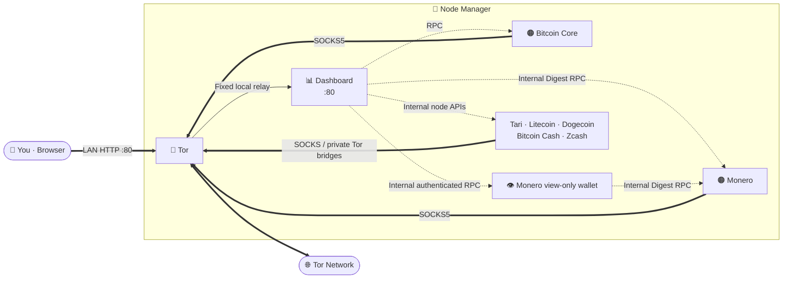

<div align="center">

# Node Manager

### A very lightweight dashboard for monitoring your new or existing nodes.

[](https://github.com/VijitSingh97/bitcoin-starter-stack/actions/workflows/ci.yml)
[](./LICENSE)


Run Bitcoin, Monero, Tari, Litecoin, Dogecoin, Bitcoin Cash, or Zcash with a
small Go dashboard. Choose any combination and click a tower in your node set
to see its status. Public runtime traffic goes through Tor; the dashboard and
optional node APIs stay on your trusted LAN.

The existing repository, package, commands, and data paths keep their current
names for upgrade compatibility while the broader Node Manager takes shape.


<sub>Preview with sample data. Your dashboard reads the nodes you configure.</sub>

</div>

---

## What it does

- 🪶 **Small dashboard, low overhead.** A single Go binary; no Python runtime or JavaScript build toolchain is needed. The full dashboard used about **8 MiB of working memory**
  in our [mini-1 benchmark](https://github.com/VijitSingh97/bitcoin-starter-stack/blob/c9cdd75/experiments/go-dashboard-results/mini-1-full-port-2026-10-27/README.md).
  Node memory and chain storage are separate; this historical measurement predates multi-chain support and the Tari gRPC client.
- 🟠 **Choose your nodes.** Bitcoin Core, Monero, Tari, Litecoin, Dogecoin,
  Bitcoin Cash Node, and Zcash through Zakura. Every chain uses pruned storage,
  a separate data directory, and an editable resource budget. Start with one
  chain on a small machine; the [per-node sizing guide](docs/nodes.md) separates
  disk planning allowances from measured evidence.
- 🧅 **Tor-only runtime networking.** P2P traffic goes through the Tor container.
  Node containers and the dashboard cannot route directly to the public internet,
  and local DNS forwarding is disabled. Bitcoin uses onion peers; inbound connections use an onion
  service when enabled. See the [privacy model](docs/privacy.md).
- 📊 **Live dashboard.** Sync progress, peers, uptime, pruned status, and disk usage (with a
  low-space warning). Start on localhost, or bind its configurable port to your private LAN IP;
  add a password and an onion address for remote access. RPC is private by default,
  with optional authenticated access where the node supports it. Tari mining gRPC and Monero ZMQ assume a trusted LAN.
- 🔑 **Separate generated logins.** Fresh installs generate different passwords for
  the dashboard and each authenticated node endpoint. The username defaults to `admin`; the wizard
  prints the selected services' credentials once. Existing passwords are preserved. Config
  renders into gitignored files, so a stray
  `git add` can't publish your RPC password — and bitcoind itself gets only a salted
  `rpcauth` hash, never the plaintext.
- ♻️ **Reuse an existing chain.** Point `data_dir` at an already-synced datadir and skip
  the multi-day initial download.
- 📟 **Opt-in node alerts & remote access.** Shared Telegram alerts (node down, sync complete, disk
  low), a [Healthchecks.io](https://healthchecks.io/) dead-man's switch for when the whole
  box goes dark, and dashboard access from anywhere via a Tor onion service — all routed
  over Tor. See [Notifications](docs/notifications.md).
- ⚙️ **Settings that stick.** Configure global Appearance, Telegram, and Healthchecks
  from the gear menu, with collapsible settings for each node's
  block alerts and LAN ports. Use localhost, your private LAN, or a password-protected onion dashboard.
  Saved values are visible in the settings panel, and a separate JSON override survives
  reboots and upgrades.
- 👀 **Bitcoin balances from your own node.** Import an address, `xpub`, `zpub`, or public
  descriptor. A pruned node scans its live UTXO set without an external address indexer;
  new imports stay pending until that scan confirms and caches a balance. A clearly
  marked public Binance
  address gives fresh installs an example; it is excluded from your totals.
  [How watch-only works](docs/watch-only.md).
- 👁️ **Monero view-only wallets.** Add a main address and private view key from the
  password-protected Monero card. No private spend key or seed is accepted, and the
  dashboard cannot sign or send. Optional signed key images make spent/current balance
  tracking accurate; without them the amount is clearly labeled received-only. Fresh
  wallet state includes the sourced Monero General Fund as a received-only example.
- 🪙 **Litecoin and Bitcoin Cash address views.** Add a public address and the
  synced local daemon scans its live UTXO set. Results are cached hourly with
  saved balance snapshots; pending or failed scans are never presented as zero.
  Sourced Linux Mint and Bitcoin Cash Node examples are excluded from personal totals.
- 🔎 **Honest reference cards.** Dogecoin and Zcash show sourced public examples
  without balances because their current pruned modes cannot supply arbitrary
  address lookup. Tari needs a separate view-only wallet service, so it has no
  bundled wallet example. The dashboard never falls back to an external explorer.
- 🔌 **Remote nodes for Pithead.** Independently enable Monero restricted RPC/ZMQ
  or Tari mining gRPC on your private LAN. Tari uses an explicit mining-method
  allowlist and needs no wallet, miner, or payout key on this server.
- 💱 **Coin prices in your currency.** USD, EUR, GBP, INR, CAD, AUD, JPY, RUB, and CNY.
  CoinGecko quotes are fetched through Tor, cached, and labeled when stale.
- ⏸️ **Pause a node without losing its data.** Type `deactivate` in the confirmation
  dialog to stop just that node and its wallet service. Its tower turns grey;
  activate it later to continue from the stored chain.
- 🛠️ **Reviewed dependency updates.** Dependabot watches image digests and libraries;
  a developer-bot workflow proposes node-binary upgrades after verifying signed
  upstream checksums. Updates arrive as pull requests.
- ⬆️ **One-command upgrades.** `./stack upgrade` fetches the latest release, backs up, and
  applies it — or flip on `dashboard.control` (one question in `./stack init`) and upgrade
  with a button from the dashboard; the stack runs the host-side agent for you.
- 🔭 **Knows when it's stale.** A daily update check (over Tor) surfaces new stack releases on
  the dashboard, and a Prometheus `/metrics` endpoint plugs into whatever
  monitoring you already run.

## 🚀 Fresh install

You need Linux with Docker Engine, or macOS with Docker Desktop, plus Compose
2.33.1 or newer and an SSD. Pick the nodes your machine has room for;
see [disk and resource planning for every chain](docs/nodes.md#storage-and-resource-planning).
The post-sync compact budgets are **1 CPU / 2 GiB per Bitcoin or Monero node**,
and **1 CPU / 4 GiB per Tari, Litecoin, Dogecoin, Bitcoin Cash, or Zcash node**.
Tor, the dashboard, Docker, the operating system, and Monero's optional view-only
wallet service need additional room. Initial sync is uncapped, so sync one chain
at a time on small hardware. These are editable container ceilings, not proven
minimum VPS specifications; complete capped stability trials remain pending.
See [Hardware Requirements](docs/hardware.md).

| Per node | Initial sync: planning estimate | After sync: default container cap |
|---|---|---|
| Bitcoin | Allow 2 CPU cores and 4 GiB RAM for headroom; more cores can speed up validation. | 1 CPU core and 2 GiB RAM |
| Monero | Allow 2 CPU cores and 4 GiB RAM for headroom; disk and Tor speed also matter. | 1 CPU core and 2 GiB RAM, experimental |
| Tari, Litecoin, Dogecoin, Bitcoin Cash, Zcash | Allow 2 CPU cores and 4 GiB RAM per node as an initial planning budget. | 1 CPU core and 4 GiB RAM per node, unqualified |

These are planning budgets, not measured average usage or hard minimums. Sync
is uncapped by default; a smaller host can work but may take longer. Each node's
`steady_cpus` and `steady_mem_limit_mb` are editable in `config.json`. Fresh APT
wizard installs activate those caps after healthy sync checks; source installs
leave automatic caps off. See [changing resource caps](docs/configuration.md#resource-caps).

### 1. Install, then run the wizard

Homebrew support for macOS and Linux is prepared for the first release that
contains this packaging. The formula is not published yet; current release
`v1.31.1` does not include it. Once released:

```bash
brew tap vijitsingh97/bitcoin-starter-stack https://github.com/VijitSingh97/bitcoin-starter-stack.git
brew install vijitsingh97/bitcoin-starter-stack/bitcoin-starter-stack
bitcoin-stack init
```

Homebrew installation is inert and leaves Docker untouched. Install and start
Docker Desktop on macOS, or Docker Engine with Compose on Linux, before running
the wizard. See the [Homebrew guide](docs/homebrew.md) for data paths, the
optional background service, and upgrade steps.

The Ubuntu APT package is prepared for the next release. The feed and signing
key are not public yet. When that release is published, first follow the
[official feed and signing-key setup](docs/privacy.md#package-feed), then run:

```bash
sudo apt update
sudo apt install bitcoin-starter-stack
sudo bitcoin-stack init
```

Package installation is inert: it does not start containers or launch setup.
Run `sudo bitcoin-stack init` explicitly. For a downloaded `.deb`, replace the
install command with `sudo apt install ./bitcoin-starter-stack_VERSION_all.deb`,
then run the same wizard. The first package release supports fresh installs; it
does not migrate an existing source-managed production node.

Until the feed is public, install the published release tarball:

```bash
curl --fail --location --output bitcoin-starter-stack.tar.gz \
  https://github.com/VijitSingh97/bitcoin-starter-stack/releases/latest/download/bitcoin-starter-stack.tar.gz
tar -xzf bitcoin-starter-stack.tar.gz
cd bitcoin-starter-stack
./stack init
```

Development branches use unpublished image tags and need their images built in
a separate development environment; they are not a fresh-install path.

### 2. Accept the safe defaults

Choose Bitcoin, Monero, or both. Press Enter at the dashboard password prompt
to generate a strong password. Each selected node gets its own different RPC
password, with username `admin`. The wizard prints the credentials once at the
end; save them in your password manager. A package install choosing both looks like:

```text
Dashboard password (letters/numbers) [Enter = strong random]:
Nodes to run — bitcoin, monero (experimental), or both [bitcoin]: both
Dashboard bind address (loopback or private LAN) [127.0.0.1]:
Bitcoin data directory [/var/lib/bitcoin-starter-stack/data/bitcoin]:
Expose Bitcoin RPC to trusted LAN wallet apps? [y/N] n
Recent-block retention in GB [10]:
Monero data directory [/var/lib/bitcoin-starter-stack/data/monero]:
Expose restricted Monero RPC to trusted LAN apps? [y/N] n
Expose Monero ZMQ to a trusted LAN P2Pool host? [y/N] n
Download missing containers and start the stack now? [Y/n]

Generated credentials (shown once):
  Dashboard — username: admin  password: <generated dashboard password>
  Bitcoin RPC — username: admin  password: <different generated Bitcoin password>
  Monero RPC — username: admin  password: <different generated Monero password>
```

Press Enter at the final question. Docker downloads the published container
images using the host's normal network settings, then the stack starts. The
wizard does not change Docker's proxy or daemon configuration. These initial
APT and container downloads happen on the host; once running, node peers,
prices, alerts, and dashboard update checks use the stack's Tor container.

Keep `127.0.0.1` to open the dashboard only on the node. For trusted-LAN access,
enter the server's private IPv4 address, such as `192.168.1.117`; wildcard and
public addresses are rejected. The source wizard uses `./data/bitcoin` and also
asks about the optional Upgrade button, which defaults to off.

Fresh APT and Homebrew wizard installs select the experimental compact resource profile:
initial sync is uncapped, then the managed host helper checks for healthy, current sync
before applying the configured per-node caps: 1 CPU and 2 GiB for Bitcoin or
Monero, and 1 CPU and 4 GiB for the other nodes. The wizard writes these values to `config.json` so you can edit
them and run `bitcoin-stack apply` (`sudo` for APT). Existing installs and
source installs keep automatic limits off. Homebrew's optional user service and
APT's host timer enforce the handoff. This mechanism applies a budget;
the longer stability tests still decide whether that budget is sufficient.

If you answer **n** at the final question, start later with:

```bash
sudo bitcoin-stack pull
sudo bitcoin-stack up
sudo bitcoin-stack status
```

For a source install, use `./stack pull`, `./stack up`, and `./stack status`.
`pull` is the explicit network action; routine `up` and `apply` use local images
only and never build or download implicitly.

### 3. Open the dashboard and let your nodes sync

Open `http://localhost` on an APT or source install. Homebrew defaults to
`http://localhost:8080`. If you chose a private LAN address, use the same port
on the server's private address. Keep the dashboard off the public
internet. Click a tower to see that chain's progress. Check logs with
`./stack logs bitcoin` or `./stack logs monero` for source installs; packages
use `sudo bitcoin-stack logs bitcoin` or `sudo bitcoin-stack logs monero`.

Bitcoin, Litecoin, and Bitcoin Cash watch-only entries remain pending during
initial block download. After sync, the node scans the live UTXO set and shows
confirmed balances; its chart contains
saved balance snapshots, not transaction history, spent outputs, or mempool
activity. Bitcoin's initial sync transfers roughly 900 GB through Tor and can take days.
See [Watch-only balances](docs/watch-only.md).
Monero's initial sync also downloads and validates historical data before
discarding the parts pruning does not retain. A pruned node saves disk, not
the initial validation work. Neither chain has a fixed sync-time guarantee.

Containers use Docker's `unless-stopped` policy. They return after a reboot when
Docker starts at boot, unless you explicitly stopped them. Day-to-day commands,
upgrades, backups, and troubleshooting are in [Operations](docs/operations.md),
and [Getting Started](docs/getting-started.md) has the fuller walkthrough.

## 📈 Monitoring

Open `http://localhost` on an APT/source node, or `http://localhost:8080` for
Homebrew. After setting a private LAN bind address,
use `http://<server-ip>` or `http://<hostname>.local` (`avahi-daemon` required).
The landing page shows a gold Bitcoin tower and an orange Monero tower. Click
one to zoom in and open its card; close it with **×**, Escape, or a click outside
the panel. Towers continue below the screen, grow on hover or keyboard
focus, and show a pulsing loading block on top. Names are hidden by default;
enable **Label towers** in the gear panel to show their names, prices, and next
block numbers. The saved default currency starts at USD. These preferences
survive restarts. Disabled nodes show **Not configured** in their card.

Every configured card shows the native status fields its daemon supplies. Across
the chains these include node version, connections, sync progress, chain storage,
native fee estimates with a 24-hour graph, and a nine-currency price selector.
Monero also shows mempool size, disk capacity/free space, latest-block age,
difficulty, estimated network hashrate, and view-only balances. Unavailable
metrics show a dash.
The **Open ports** section shows configured LAN RPC/ZMQ access or **Disabled**;
it does not scan ports or expose the internal administration listener.
The following extra features belong to the Bitcoin card:

- **Node mode** — a **Full** or **Pruned** badge in the header.
- **Sync progress** — block height vs. headers, with a progress bar.
- **Peers** — total connections, inbound vs. outbound.
- **Disk** — chain size on disk vs. drive capacity.
- **Mempool & fees** — transaction backlog and sat/vB estimates for the next / ~30-min / ~1-hour
  blocks (once synced), with a 24-hour fee sparkline.
- **Watch-only balances** — add `xpub`s/descriptors from the UI; per-key balances and a total
  (shown for multiple personal wallets), read off your own node. The public example
  is excluded from personal totals; first scans stay pending and show their scan-height
  freshness until a result is cached
  ([Watch-only](docs/watch-only.md)).
- **BTC price** — CoinGecko quotes in USD, EUR, GBP, INR, CAD, AUD, JPY, RUB, or CNY, fetched through
  Tor every five minutes. The selector remembers your currency; stale quotes are labeled.
- **Versions** — Bitcoin Core version in the card, stack version in the footer.
- **Theme** — follows your system light/dark setting; the top-right toggle cycles
  Auto → Light → Dark and remembers your choice.
- **Live block tower** — a day-clock: a 12×12 layer is one UTC day. It fills to the current
  time of day at Bitcoin's ~10-minute spacing (one cube per 10 UTC minutes); the loading
  slot **pulses**, and a **loading block N** header shows the next block. At midnight the
  day is pushed down and a fresh one starts. Driven purely by the clock — no history or node
  lookups. Theme-aware and paused for `prefers-reduced-motion`.

The Monero card has the same price, fee-history, status, disk, uptime, and wallet
sections. Its fees are native XMR-per-kB estimates. Monero wallet rows remain
pending during their first scan; amounts are verified as current only when fresh,
complete key-image coverage is present. Litecoin and Bitcoin Cash cards accept
address-only confirmed-UTXO snapshots. Dogecoin and Zcash show reference-only
examples without balances, and Tari has no wallet example.

The status page, notification gear, and sourced public examples can be used without a
password; when configured, the password protects the whole dashboard. Personal
wallet views, wallet changes, and upgrades require one. LAN HTTP is unencrypted:
use a trusted LAN or the onion service, and keep the configured dashboard port
off the public internet.

## 🏗️ How it works



Shared Tor and dashboard services add two containers to the selected daemons.
Monero's optional view-only wallet service adds one more.
Nodes and the Go dashboard share an internal network;
only Tor joins an external network. The Tor container also forwards the private
LAN dashboard port to its fixed internal destination.
[Architecture](docs/architecture.md) explains the layout; [Privacy](docs/privacy.md)
covers downloads, DNS, and the limits of the guarantee.

## 📚 Documentation

| Guide | What's inside |
|---|---|
| [Getting Started](docs/getting-started.md) | Prerequisites, install, first start, what to expect during sync. |
| [Homebrew](docs/homebrew.md) | macOS and Linuxbrew install, paths, background service, and upgrades. |
| [Supported nodes](docs/nodes.md) | All seven chains, storage and resource budgets, and Pithead remote-node settings. |
| [Hardware Requirements](docs/hardware.md) | CPU, RAM, disk sizing — with real numbers from a reference box. |
| [Configuration](docs/configuration.md) | Every `config.json` key, applying changes, reusing an existing node. |
| [Watch-only](docs/watch-only.md) | Read-only Bitcoin, Monero, Litecoin, and Bitcoin Cash views, plus the limits of the other chains. |
| [Tor & Privacy](docs/privacy.md) | Enforced runtime routing, LAN access, and the host-download boundary. |
| [Architecture](docs/architecture.md) | Services, network layout, and privacy model. |
| [Operations](docs/operations.md) | Commands, health checks, upgrades, backup, troubleshooting. |
| [Notifications & Remote Access](docs/notifications.md) | Telegram alerts, a Healthchecks.io dead-man's switch, and reaching the dashboard over Tor. |
| [Releasing](https://github.com/VijitSingh97/bitcoin-starter-stack/blob/main/docs/releasing.md) | Maintainer guide to versions, release gates, and tarballs. |

## 🧪 Testing

Tests and development tools are kept in the Git checkout. Release downloads contain
the runtime source, configuration, license, security policy, changelog, and user guides;
they omit tests, parity fixtures, benchmarks, screenshots, and maintainer tools.

```bash
tests/run.sh
```

Runs shellcheck, `configure.sh` and CLI tests, a docker-compose contract test, a
release-consistency check, an upgrade-path test, Go race/vet/unit checks, the retained Python
reference suite, cross-runtime HTTP parity tests, frontend tests, and a real end-to-end boot
whose **egress tests attempt direct IP and DNS access with Tor stopped** —
the same suite [CI](.github/workflows/ci.yml) runs on every push, plus a full image build,
secret scanning (gitleaks), and Dockerfile lint (hadolint). See
[CONTRIBUTING.md](https://github.com/VijitSingh97/bitcoin-starter-stack/blob/main/CONTRIBUTING.md).

## ⚠️ Disclaimer

**USE AT YOUR OWN RISK.** This software is provided "as is" without any warranties. Running
a full node is resource-intensive (bandwidth, disk, memory). Understand your firewall setup
before exposing anything beyond your LAN. Security posture and reporting:
[SECURITY.md](SECURITY.md). Licensed [MIT](LICENSE).

The screenshot uses public and fictional demo data. “Your Wallet” illustrates a
pending import. A single public address is not an exchange’s total reserves or
proof of solvency.

The dashboard runtime is Go; Python remains in the development test harness only.
Bitcoin imports accept public material only. Monero view-only imports require a
private view key, but never a private spend key, seed phrase, signing key, or send permission.
