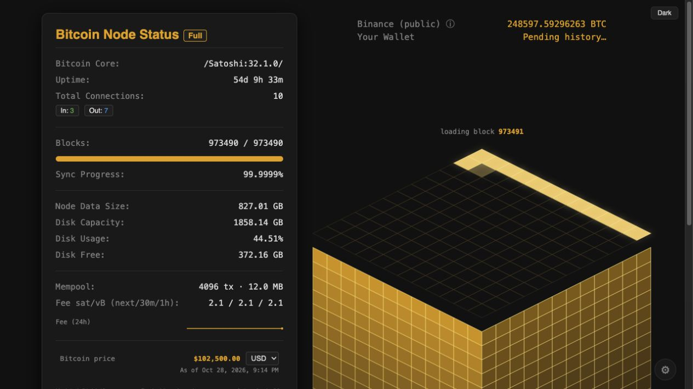
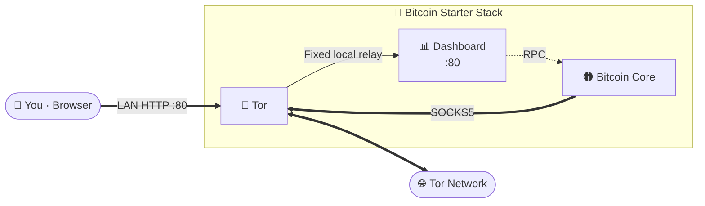

<div align="center">

# Bitcoin Starter Stack

### A very lightweight dashboard for monitoring your new or existing Bitcoin node.

[](https://github.com/VijitSingh97/bitcoin-starter-stack/actions/workflows/ci.yml)
[](./LICENSE)


Run a [Bitcoin Core](https://bitcoincore.org/) node with a small Go dashboard.
Watch blocks arrive, track your own watch-only balances, check fees and BTC prices,
and get alerts when something needs attention. Internet traffic uses Tor; your
wallet addresses stay on your node.



</div>

---

## What it does

- 🪶 **Small dashboard, low overhead.** A single Go binary with no third-party
  runtime dependencies. The full dashboard used about **8 MiB of working memory**
  in our [mini-1 benchmark](https://github.com/VijitSingh97/bitcoin-starter-stack/blob/c9cdd75/experiments/go-dashboard-results/mini-1-full-port-2026-10-27/README.md).
  Bitcoin Core's memory and chain storage are separate.
- 🟠 **Fully validating, pruned by default.** Bitcoin Core validates every block, then keeps
  10 GB of recent blocks. Plan on **30–60 GB total disk**; archival storage remains an
  advanced manual option.
- 🧅 **Tor-only networking.** All P2P traffic goes through the Tor container
  (`onlynet=onion`). Bitcoin and the dashboard cannot route directly to the internet,
  and local DNS forwarding is disabled. Inbound Bitcoin connections use an onion
  service when enabled. See the [privacy model and Tor bootstrap](docs/privacy.md).
- 📊 **Live dashboard.** Sync progress, peers, uptime, pruned status, and disk usage (with a
  low-space warning). Start on localhost, or bind port `80` to your private LAN IP;
  add a password and an onion address for remote access. RPC is private by default,
  with optional authenticated access for wallets on your LAN.
- 🔑 **One generated login.** Fresh installs share one strong password between RPC and
  the dashboard and use username `admin`; the wizard prints the new login once. Config
  renders into gitignored files, so a stray
  `git add` can't publish your RPC password — and bitcoind itself gets only a salted
  `rpcauth` hash, never the plaintext.
- ♻️ **Reuse an existing chain.** Point `data_dir` at an already-synced datadir and skip
  the multi-day initial download.
- 📟 **Opt-in alerts & remote access.** Telegram alerts (node down, sync complete, disk
  low), a [Healthchecks.io](https://healthchecks.io/) dead-man's switch for when the whole
  box goes dark, and dashboard access from anywhere via a Tor onion service — all routed
  over Tor. See [Notifications](docs/notifications.md).
- ⚙️ **Notification settings that stick.** Configure Telegram, Healthchecks, and
  new-block alerts from the gear menu on localhost, your private LAN, or the onion dashboard.
  Secrets stay masked and a separate JSON override survives reboots and upgrades.
- 👀 **Balances from your own node.** Import an address, `xpub`, `zpub`, or public
  descriptor. A pruned node scans its live UTXO set without an external address indexer;
  new imports stay pending until that scan confirms and caches a balance. A clearly
  marked public Binance
  address gives fresh installs an example; it is excluded from your totals.
  [How watch-only works](docs/watch-only.md).
- 💱 **BTC in your currency.** USD, EUR, GBP, INR, CAD, AUD, JPY, RUB, and CNY.
  CoinGecko quotes are fetched through Tor, cached, and labeled when stale.
- ⬆️ **One-command upgrades.** `./stack upgrade` fetches the latest release, backs up, and
  applies it — or flip on `dashboard.control` (one question in `./stack init`) and upgrade
  with a button from the dashboard; the stack runs the host-side agent for you.
- 🔭 **Knows when it's stale.** A daily update check (over Tor) surfaces new stack releases on
  the dashboard, and a Prometheus `/metrics` endpoint plugs into whatever
  monitoring you already run.

## 🚀 Quick Start

An Ubuntu 24.04 APT package is prepared for the next release. The public feed
will not be enabled until that release publishes matching Go dashboard images.
Until then, use the source or release-tarball installation below.

**Prerequisites:** Ubuntu Server 24.04 with [Docker Engine](https://docs.docker.com/engine/install/ubuntu/),
`jq` and `curl`, an SSD with 30–60 GB free for the default
[pruned](docs/configuration.md#pruned-node) setup (about 1 TB for archival), and 8 GB+ RAM.
Details in [Hardware Requirements](docs/hardware.md).

First set up [Tor for downloads](docs/privacy.md#bootstrap-and-apt), including the
initial Tor image and Docker's proxy. There is no automatic clearnet fallback.
With the source and images available locally:

```bash
cd bitcoin-starter-stack
./stack init              # optional guided setup; defaults to 10 GB block retention
./stack up                # creates local settings and starts preloaded images
```

The internal RPC password is generated for you. Runtime images are prebuilt for
amd64 and arm64; the node does not need a compiler or Python. `./stack pull`
fetches images after checking the host's Tor proxy. Unreleased development builds
are kept separate from the deployment path.

For LAN access, set `dashboard.bind_ip` to the server's private IPv4 address in
`config.json`, then run `./stack apply`. The default is local access only.
[Configuration](docs/configuration.md) covers pruning, existing chain data, alerts,
and optional remote access through an onion service.

Then watch it come up:

```bash
./stack status            # container + health summary
./stack logs tor          # wait for "Bootstrapped 100% (done)"
./stack logs bitcoin      # headers, then block sync
```

`./stack` wraps day-to-day operations (`up`, `down`, `logs`, `status`,
`doctor`, `apply`, `upgrade`, `backup`/`restore`) — see [Operations](docs/operations.md).
Upgrading is one command: **`./stack upgrade`** fetches the latest release,
backs up, and applies it.

The node still downloads and validates the whole historical chain, currently roughly
900 GB, before pruning old block files. Over Tor this can take days. Full walkthrough:
[Getting Started](docs/getting-started.md).

## 📈 Monitoring

Open `http://localhost` on the node. After setting a private LAN bind address,
use `http://<server-ip>` or `http://<hostname>.local` (`avahi-daemon` required).

- **Node mode** — a **Full** or **Pruned** badge in the header.
- **Sync progress** — block height vs. headers, with a progress bar.
- **Peers** — total connections, inbound vs. outbound.
- **Disk** — chain size on disk vs. drive capacity.
- **Mempool & fees** — transaction backlog and sat/vB estimates for the next / ~30-min / ~1-hour
  blocks (once synced), with a 24-hour fee sparkline.
- **Watch-only balances** — add `xpub`s/descriptors from the UI; per-key balances and a total
  (shown for multiple personal wallets), read off your own node. The public example
  is excluded from personal totals; first scans stay pending and show their scan-height
  freshness until a result is cached
  ([Watch-only](docs/watch-only.md)).
- **BTC price** — CoinGecko quotes in USD, EUR, GBP, INR, CAD, AUD, JPY, RUB, or CNY, fetched through
  Tor every five minutes. The selector remembers your currency; stale quotes are labeled.
- **Versions** — Bitcoin Core version in the card, stack version in the footer.
- **Theme** — follows your system light/dark setting; the top-right toggle cycles
  Auto → Light → Dark and remembers your choice.
- **Live block tower** — a day-clock: a 12×12 layer is one UTC day. It fills to the current
  time of day at Bitcoin's ~10-minute spacing (one cube per 10 UTC minutes); the loading
  slot **pulses**, and a **loading block N** header shows the next block. At midnight the
  day is pushed down and a fresh one starts. Driven purely by the clock — no history or node
  lookups. Theme-aware and paused for `prefers-reduced-motion`.

The status page, notification gear, and public example can be used without a
password; when configured, the password protects the whole dashboard. Personal
wallet views, wallet changes, and upgrades require one. LAN HTTP is unencrypted:
use a trusted LAN or the onion service, and keep port `80` off the public internet.

## 🏗️ How it works



Three containers. Bitcoin Core and the Go dashboard share an internal network;
only Tor joins an external network. The Tor container also forwards the private
LAN dashboard port to its fixed internal destination.
[Architecture](docs/architecture.md) explains the layout; [Privacy](docs/privacy.md)
covers downloads, DNS, and the limits of the guarantee.

## 📚 Documentation

| Guide | What's inside |
|---|---|
| [Getting Started](docs/getting-started.md) | Prerequisites, install, first start, what to expect during sync. |
| [Hardware Requirements](docs/hardware.md) | CPU, RAM, disk sizing — with real numbers from a reference box. |
| [Configuration](docs/configuration.md) | Every `config.json` key, applying changes, reusing an existing node. |
| [Watch-only](docs/watch-only.md) | Show `xpub`/descriptor balances on the dashboard, read off your own node. |
| [Tor & Privacy](docs/privacy.md) | Enforced routing, LAN access, host downloads, and bootstrap. |
| [Architecture](docs/architecture.md) | The three services, network layout, and privacy model. |
| [Operations](docs/operations.md) | Commands, health checks, upgrades, backup, troubleshooting. |
| [Notifications & Remote Access](docs/notifications.md) | Telegram alerts, a Healthchecks.io dead-man's switch, and reaching the dashboard over Tor. |
| [Releasing](https://github.com/VijitSingh97/bitcoin-starter-stack/blob/main/docs/releasing.md) | Maintainer guide to versions, release gates, and tarballs. |

## 🧪 Testing

Tests and development tools are kept in the Git checkout. Release downloads contain
the runtime source, configuration, license, security policy, changelog, and user guides;
they omit tests, parity fixtures, benchmarks, screenshots, and maintainer tools.

```bash
tests/run.sh
```

Runs shellcheck, `configure.sh` and CLI tests, a docker-compose contract test, a
release-consistency check, an upgrade-path test, Go race/vet/unit checks, the retained Python
reference suite, cross-runtime HTTP parity tests, frontend tests, and a real end-to-end boot
whose **egress tests attempt direct IP and DNS access with Tor stopped** —
the same suite [CI](.github/workflows/ci.yml) runs on every push, plus a full image build,
secret scanning (gitleaks), and Dockerfile lint (hadolint). See
[CONTRIBUTING.md](https://github.com/VijitSingh97/bitcoin-starter-stack/blob/main/CONTRIBUTING.md).

## ⚠️ Disclaimer

**USE AT YOUR OWN RISK.** This software is provided "as is" without any warranties. Running
a full node is resource-intensive (bandwidth, disk, memory). Understand your firewall setup
before exposing anything beyond your LAN. Security posture and reporting:
[SECURITY.md](SECURITY.md). Licensed [MIT](LICENSE).

The screenshot uses public and fictional demo data. “Your Wallet” illustrates a
pending import. A single public address is not an exchange’s total reserves or
proof of solvency.

The dashboard runtime is Go; Python remains in the development test harness only.
Only public keys, public descriptors, and addresses are accepted for watch-only imports.
