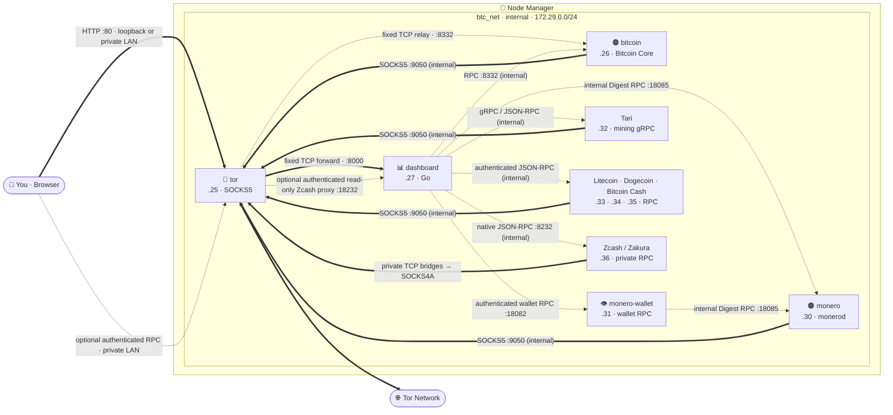

# Architecture

Tor, the dashboard, and each selected node share the internal `btc_net` bridge (`172.29.0.0/24`). Only
Tor also joins the external `tor_egress` bridge.

## The services

| Service | Image | Runs as | Role |
|---|---|---|---|
| `tor` | `alpine:3.24` + tor (built locally) | `tor` user | Outbound SOCKS5 proxy at `172.29.0.25:9050`. Fresh onion identity per volume. |
| `bitcoin` | [`bitcoin/bitcoin`](https://hub.docker.com/r/bitcoin/bitcoin) (official, digest-pinned) | `1000:1000` | Full or pruned node. `-datadir=/data` bind-mounted from the host. Credentials, `dbcache`, and `prune` injected from `.env` at runtime. |
| `monero` | Pinned, SHA-256 verified upstream Monero binary | `1000:1000` | Optional pruned node. Restricted Digest RPC, separately opt-in LAN RPC and ZMQ. |
| `monero-wallet` | Same verified Monero image | `1000:1000` | Internal-only watch wallet RPC. Encrypted wallet files use a dedicated volume; no host port or public route. |
| `tari` | Official digest-pinned `ghcr.io/tari-project/minotari_node` | `1000:1000` | Pruned base node, Tor transport, mining gRPC allowlist; no wallet or miner. |
| `litecoin`, `dogecoin`, `bitcoincash` | Pinned upstream binaries, verified against signed release checksums | Non-root image user | Separate pruned nodes with authenticated RPC and Tor proxies. |
| `zcash` | Official digest-pinned `zakuracore/zakura` | Image entrypoint drops to `10001` | Pruned state, four private Tor bootstrap bridges, and internal native RPC. |
| `dashboard` | `alpine:3.24` + a static Go binary (built locally) | `1000:1000` | Polls the node over RPC every page load; reads the data dir read-only for disk stats. |

Static IPs keep the bitcoin entrypoint's `-proxy=` argument (in
`docker-compose.yml`) and the dashboard's RPC URL simple and deterministic.
Docker Compose 2.33.1 or newer is required for the gateway-priority setting
that makes `tor_egress` Tor's deterministic default route.

## Privacy model

- **`-onlynet=onion` + `-proxy=…`**, set by the bitcoin entrypoint in
  [docker-compose.yml](../docker-compose.yml), plus **`listen=0`** in
  [bitcoin.conf](../build/bitcoin/bitcoin.conf): every P2P connection is
  routed to onion peers through the Tor container. The node never dials
  clearnet; inbound peers use the optional onion service, disabled by default.
- **The application network is internal.** Bitcoin and dashboard have no
  external route and use loopback-only DNS, so a proxy bug fails closed.
  Tor alone joins `tor_egress`; its gateway has explicit priority. The host
  dashboard and optional LAN RPC ports terminate in Tor's container and forward
  only to fixed internal addresses.
- **The additional nodes use the same boundary.** Tari, Litecoin, Dogecoin,
  and Bitcoin Cash use the internal Tor proxy. Zakura has no native SOCKS
  transport here: four fixed TCP bridges send bootstrap peer connections through
  Tor with remote DNS resolution. Direct discovered-peer connections fail closed.
  Native Zakura RPC stays private; optional LAN RPC passes through the Go server's
  separate authenticated, read-only method allowlist. See [network details](privacy.md).
- **Monero uses the same isolated network.** Both P2P sync and transaction relay
  use Tor; DNS checkpoints and update checks are disabled. Restricted RPC and
  ZMQ are separate private-LAN relays owned by the Tor container. The authenticated
  unrestricted RPC listener at internal port 18085 supplies complete dashboard
  metrics; it has no host relay or published port. LAN clients use restricted
  port 18081. ZMQ has no authentication. The separate wallet service at internal
  port 18082 accepts only authenticated dashboard traffic, uses a read-only root
  filesystem, and has neither an external route nor a host port.
- **Inbound onion service** (`inbound_onion` in `config.json`, opt-in):
  bitcoind registers an onion address over tor's cookie-authed control
  port and serves blocks to the network — still no clearnet, no host port,
  no IP exposure. The tor data volume is mounted read-only into the
  bitcoin container (whose process joins tor's group) so it can read the
  control-auth cookie.
- **RPC auth is a salted hash.** bitcoind is started with `rpcauth=`; the
  plaintext password exists only in the dashboard container and `.env`.
  The bitcoin health check authenticates with Core's `.cookie` file.
- **The only published port by default is the dashboard's `80`.** It binds to
  `127.0.0.1` by default; `dashboard.bind_ip` accepts only loopback or RFC1918
  host addresses for intentional LAN access. `bitcoin.rpc_expose` can publish
  authenticated RPC on a private host address through Tor's TCP relay;
  `rpcallowip` still restricts Core to Docker's address space. SOCKS (`9050`)
  and the Tor control port (`9051`) are not published to the host. The optional
  dashboard onion service adds reachability through Tor without another host port.
- **Notification egress rides Tor too.** Telegram messages and
  Healthchecks.io pings (both opt-in) go through the tor container's SOCKS
  proxy (`socks5h`, so even DNS resolves through Tor) — enabling alerts
  never turns the stack into a clearnet beacon.
- **All coin prices use the same Tor proxy.** Background CoinGecko requests every five
  minutes cache nine fiat quotes; page loads and currency changes only read the
  cache. DNS resolves through Tor, TLS is verified, and failures never fall back to
  a direct connection. Quotes become stale after a failed fetch or fifteen minutes.

## Trust boundaries — and non-boundaries

- Fresh installs generate separate dashboard and authenticated node RPC logins,
  plus Monero wallet RPC and encrypted-wallet-file passwords. Tari mining gRPC
  and Monero ZMQ rely on the trusted LAN boundary. Existing deployments
  may keep an empty or separate `dashboard.password`. The default host bind is loopback; set a private
  `dashboard.bind_ip` to make LAN exposure intentional. See
  [SECURITY.md](../SECURITY.md).
  Personal wallet views and all wallet/upgrade mutations require a configured
  password; sourced public examples are readable without one.
- The opt-in Upgrade button keeps the container↔host boundary intact: the
  dashboard writes a fixed marker file to its own volume — content never read,
  no Docker socket, no host access — and the host-side `upgrade-agent` polls
  for the marker and runs the same predetermined `./stack upgrade` you would.
  That upgrade marker can only request the latest release
  ([Upgrade button](operations.md#upgrade-button-opt-in)).
- LAN port controls use a separate typed request in the same private volume.
  A host helper validates the request, private LAN bind, ports, saved RPC
  credentials, Compose ownership, and host/Docker port availability before any
  restart, then updates only the selected RPC/ZMQ
  listener fields in server config and applies it offline. The dashboard cannot
  publish a public listener, choose host paths, run commands, or access Docker.
  Source installs reuse the host agent; APT installs use a dedicated hardened
  systemd timer. Port changes require the dashboard password.
  A compromised dashboard process can exercise these allowed LAN-listener
  controls; the helper limits its actions rather than independently authenticating the operator.
- Node activation uses another fixed, typed request. The host validates the node
  identity and saved configuration, then starts or gracefully stops only that
  node and its dependent wallet service. Data is retained. Failed changes restore
  the prior configuration and service state; the dashboard waits for the host's
  result before marking a tower inactive.
- Docker host access is **not** a boundary: `docker inspect` reveals RPC
  credentials. Anyone who can run Docker commands owns the box anyway.

## Startup behavior

The bitcoin entrypoint deletes stale `*.lock`/`LOCK` files before starting
bitcoind — recovery from hard power-offs, safe because `container_name`
guarantees a single instance. `stop_grace_period: 5m` gives Bitcoin Core
time to flush its cache on shutdown; don't `docker kill` it.
